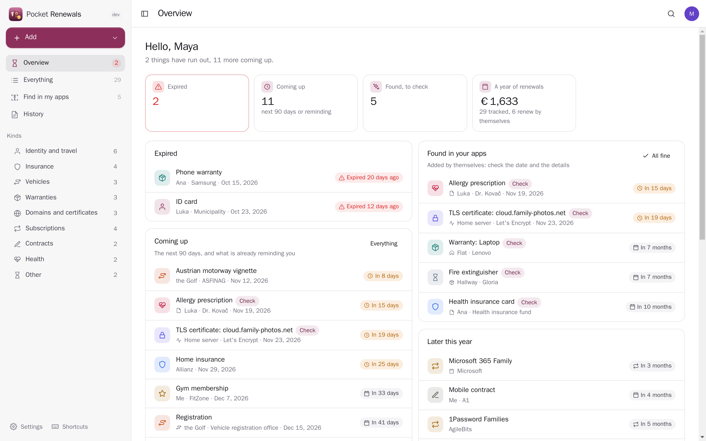
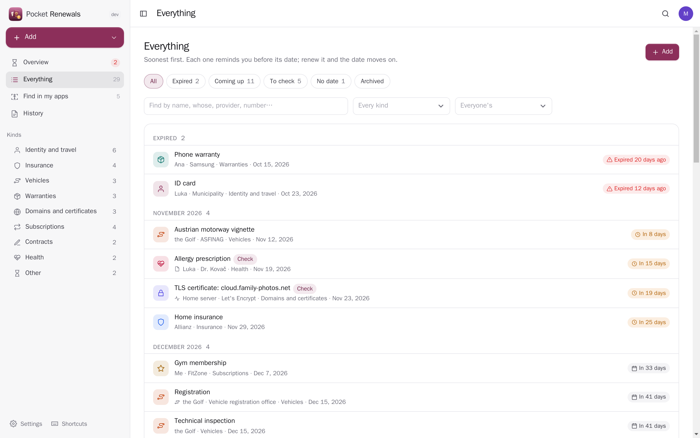
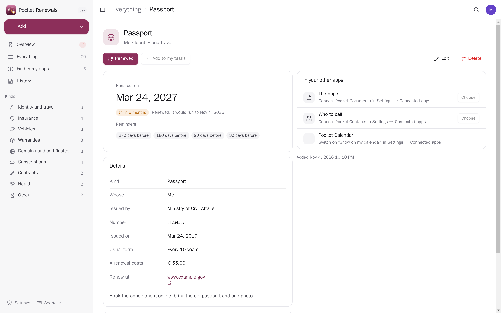
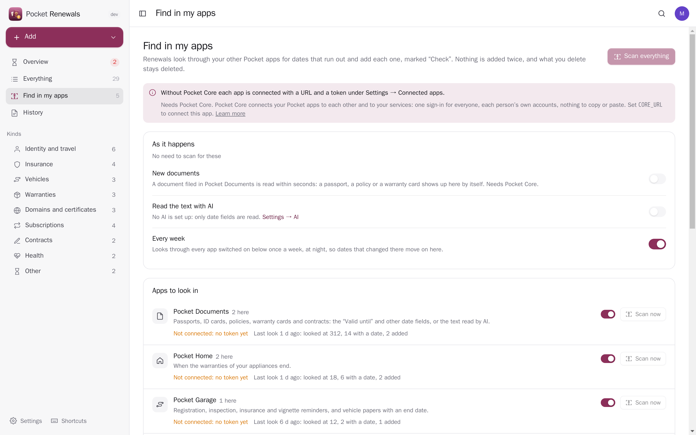
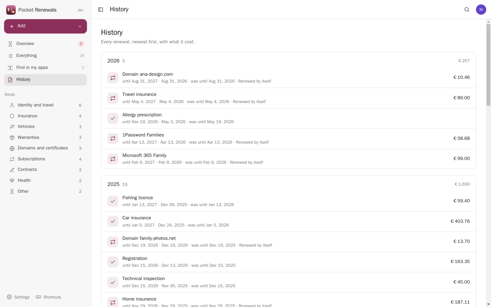
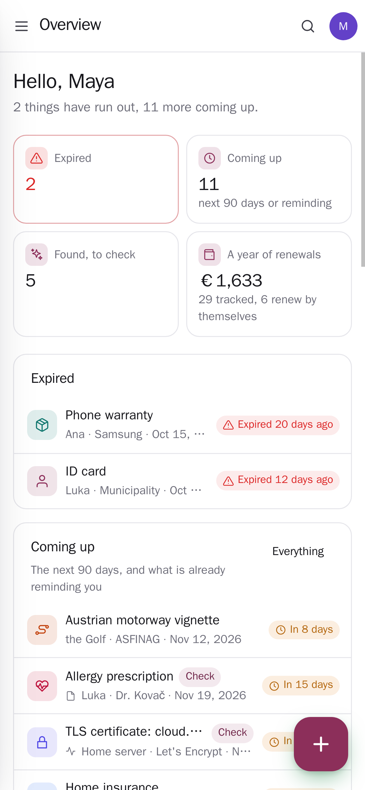
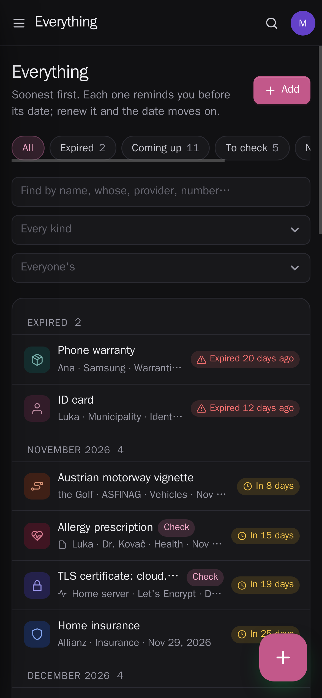

<p align="center"></p>
<h1 align="center">Pocket Renewals</h1>
<p align="center">Everything that runs out, in one list: passports and ID cards, driving licences, insurance, the car's registration and inspection, warranties, domains, TLS certificates, subscriptions and contracts. Each one reminds you well before its date (a passport months ahead, a certificate days ahead, a contract before its notice period), renewing it moves the date on and keeps the history, and the dates find themselves: a passport scanned into Pocket Documents, an appliance's warranty in Pocket Home, the car's registration in Pocket Garage, a certificate in Pocket Monitoring or a yearly subscription in Pocket Money shows up here by itself.<br>One Go binary, one SQLite file, one volume. Part of the Pocket apps; works on its own too.</p>
<p align="center">
  <a href="https://github.com/abjelosevic88/pocket-homelab-renewals/actions"></a>
  <a href="https://github.com/abjelosevic88/pocket-homelab-renewals/pkgs/container/pocket-homelab-renewals"></a>
  <a href="LICENSE"></a>
</p>

---

<p align="center"></p>

| | |
|---|---|
|  |  |
|  |  |
|  |  |

## What it does

- **One list of what runs out**, soonest first and by month: expired, coming up, later, no date yet. Whose it is (you, a child, the car), who issued it, the number, the usual term, what a renewal costs and where to renew it.
- **Reminders that fit the thing**: a passport 9, 6, 3 and 1 months ahead, insurance 45, 14 and 3 days, a certificate 21, 7 and 2 days — or your own days. A notice period or the weeks a new passport takes add a reminder before the last day to act. One message a day, through Apprise, ntfy or any JSON webhook.
- **Renewed**: the new date (one term on, suggested), what it cost — booked in Pocket Money if you like — and a note; the history keeps every renewal. Subscriptions and domains on auto-renew move on by themselves.
- **Found in your other apps**, marked “Check” until you look:
  - **Pocket Documents** — the “Valid until” and other date fields, or (with AI) the text of passports, policies, contracts and warranty cards; a new document is read **within seconds of being filed**.
  - **Pocket Home** — appliance warranties. **Pocket Garage** — registration, inspection, insurance and vignette reminders, vehicle papers with an end date. **Pocket Inventory** — things with an expiry date that are not food. **Pocket Monitoring** — TLS certificates. **Pocket Money** — yearly subscriptions. **Pocket Email** — renewal notices, read by AI.
  - Nothing is added twice; a later date there moves it on here; what you delete stays deleted. A weekly scan keeps it all current.
- **Before you travel**: a passport, ID or visa that runs out before a trip in Pocket Travel ends — or within the six months many countries ask for — shows on the overview.
- **The rest of the box**: dates on your Pocket Calendar, “renew it” on your Pocket Tasks, the scan kept from Pocket Documents, who to call from Pocket Contacts. Pocket AI can answer “what runs out this month?”.
- Per person: everyone has their own list and connections; admins do not see anyone else's. Light and dark, phone first, a JSON export/import and a CSV of the list.

## Run it

```sh
docker run -d --name pocket-renewals -p 8080:8080 -v ./data:/data \
  -e BASE_URL=https://renewals.example.com -e SECURE_COOKIES=true \
  ghcr.io/abjelosevic88/pocket-homelab-renewals:latest
```

or `docker compose up -d` with [docker-compose.yml](docker-compose.yml). Open it, create the first account and add something, or connect your apps. All options: [docs/configuration.md](docs/configuration.md). API: [docs/api.md](docs/api.md). Backups: [docs/backup.md](docs/backup.md).

Try it with example data: `make run` (or `DEMO_DATA=true AUTH_MODE=none ./pocket-renewals`).

## With Pocket Core

Set `CORE_URL` and `CORE_REGISTRATION_KEY` and Renewals joins the box: people sign in with Pocket Core, and through app links each person's renewals reach their own Pocket apps with nothing to paste:

| App | What for | Scopes |
|---|---|---|
| Pocket Documents | end dates in your documents, new documents as they are filed, the scan kept with a renewal | `documents:read`, `events:read` |
| Pocket Home | appliance warranties | `home:read` |
| Pocket Garage | registration, inspection, insurance reminders and vehicle papers | `vehicles:read` |
| Pocket Inventory | expiry dates on your shelves | `items:read` |
| Pocket Monitoring | TLS certificates | `monitoring:read` |
| Pocket Money | yearly subscriptions; what a renewal cost, as a transaction | `accounts:read`, `transactions:read`, `transactions:write` |
| Pocket Email | renewal notices (with AI) | `mail:read` |
| Pocket Travel | passports and visas against your trips | `trips:read` |
| Pocket Calendar | the dates as all-day events | `calendar:read`, `calendar:write` |
| Pocket Tasks | “renew it” on your list | `tasks:write` |
| Pocket Contacts | who to call | `contacts:read` |

Other apps can read your renewals (`renewals:read`: Pocket AI's briefing, Pocket Day's journal) or add and renew them (`renewals:write`). Events on the bus: `renewals.added`, `renewals.found`, `renewals.due`, `renewals.expired`, `renewals.renewed`. Without Core every connection can be made directly with a URL and a token; the Core-only choices stay visible, greyed out.

## Build

Go 1.26 and Node 22. `make` builds the web UI and the binary, `make test` runs vet, the Go tests and the TypeScript check, `make run` starts it with example data. Releases for Linux (amd64, arm64, armv7), macOS, Windows and FreeBSD, and a multi-arch image on ghcr.io.

## License

MIT © 2026 Aleksandar Bjelosevic
